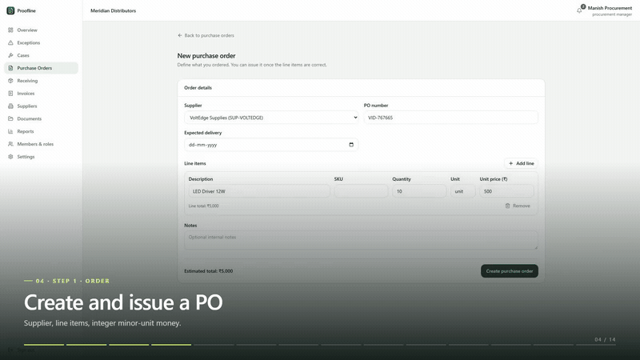

# Proofline — Product Demo (real multi-role interactions)

A **two-minute demo built from actual recorded interactions** with the running app — not
screenshots. Playwright drives the real UI as four different users (procurement manager,
warehouse receiver, finance, supplier) and records each step; FFmpeg trims the clips, adds
step-by-step captions, lays a music bed under it and exports the MP4.

- **Deliverable:** [`out/proofline-demo.mp4`](out/proofline-demo.mp4) — 1920×1080, 30 fps,
  **128.5 s**, H.264 + AAC stereo, **background music, no voice-over**.
- **Watch online:** https://youtu.be/QUia9HSccXc
- **On the website:** the landing page has a **Demo** section (`/#demo`) with the video embedded,
  plus a “Watch the demo” button in the hero.
- **Source app:** https://proofline-inky.vercel.app (API: https://proofline-n9bo.onrender.com)

[](https://youtu.be/QUia9HSccXc)

▶ **YouTube:** https://youtu.be/QUia9HSccXc · 📄 **MP4:** [`out/proofline-demo.mp4`](out/proofline-demo.mp4)

The preview is a silently looping GIF (GitHub strips `<video>` and `<iframe>` from markdown, so an
image is the only autoplay that works there). The full video has music.

<!-- Autoplay preview for local/IDE markdown renderers; GitHub strips <video>, so the poster link above is the portable version. -->
<video src="out/proofline-demo.mp4" poster="assets/demo-poster.jpg" autoplay muted loop playsinline controls width="100%"></video>

<details>
<summary>Embed on a website (iframe)</summary>

```html
<iframe
  width="100%"
  style="aspect-ratio:16/9;border:0"
  src="https://www.youtube-nocookie.com/embed/QUia9HSccXc?rel=0"
  title="Proofline product demo"
  allow="accelerometer; autoplay; clipboard-write; encrypted-media; gyroscope; picture-in-picture"
  allowfullscreen
></iframe>
```

</details>

## The flow you see (9 numbered steps, 4 roles, all real)

| # | Caption / step | Role on screen | What actually happens |
| --- | --- | --- | --- |
| — | Hook | — | Real seeded numbers: 100 ordered · 94 arrived · 100 billed |
| — | Landing | — | The live landing page, scrolling the workflow section |
| — | Sign in | Procurement manager | Typing credentials → submit |
| — | Live workspace | Procurement manager | `Welcome back, Manish` + open cases / disputed value |
| 1 | Order | Procurement manager | Create a PO → **Issue** (`VID-767665`) |
| — | Sign in | Warehouse receiver | Typing credentials → submit |
| — | Receiver workspace | Warehouse receiver | Role-scoped navigation — **no invoices, no cases** |
| 2 | Receive | Warehouse receiver | 10 received, 1 damaged, delivery ref → **Submit receipt** |
| — | Sign in | Finance | Typing credentials → submit |
| — | Finance workspace | Finance | `Welcome back, Fatima` |
| 3 | Bill | Finance | Create `INV-VID-767665` matched to the PO → **Review** |
| 4 | Detect | Finance | Reviewed invoice shows **4 discrepancies** (expected vs actual) |
| 5 | Dispute | Procurement manager | New case from the over-delivery exception (`CASE-1006`) |
| 6 | Review | Procurement manager | `Open → Under Review`, credit note proposed |
| 7 | Approve | Procurement manager | **Approve** → credit note approved |
| 8 | Verify | Finance | **Verify** → resolution verified, case **Resolved** |
| 9 | Supplier | Supplier (BrightTech) | Signs in to their own portal and replies (`CASE-1001`) |

No failure is staged: this cut contains **no error scene**. Every visible state change is a
real server response.

## Deliverables

| Path | What it is |
| --- | --- |
| `out/proofline-demo.mp4` | Final encoded video (128.5 s) |
| `recordings/*.webm` | The real interaction clips (source of truth) + `session.json` |
| `captions/*.png` | Caption overlays (14 scenes) + hook/end cards |
| `assets/logo.png` | Brand mark |
| `assets/music.mp3` | Background track (`The Mountain` — SaaS Systems, user-supplied) |
| `scripts/record.mjs` | Manager → receiver → finance → case journey |
| `scripts/record-extra.mjs` | Reviewed invoice with the detected discrepancies |
| `scripts/record-resolution.mjs` | Resolution beat: propose → approve → verify (waits for the result) |
| `scripts/captions.mjs` | Renders the caption overlays and hook/end cards |
| `scripts/compose.mjs` | Trims, overlays captions, builds the music bed, concatenates, encodes |
| `scripts/qc.mjs` | Verifies the export (duration/fps/frames/streams/audio/blank frames) |
| `verification.md` | QC report, evidence and honesty checks |

## Reproduce

Requires Node 20+ and Playwright chromium (`pnpm exec playwright install chromium` at the repo root).

```bash
cd proofline-product-demo
npm install
npm run record            # manager, receiver, finance, case, supplier (creates demo records)
npm run record:extra      # reviewed invoice + discrepancies
npm run record:resolution # propose → approve → verify on one case
npm run captions          # caption + hook/end PNGs
npm run compose           # trim, overlay, music, concat, encode
npm run qc                # print the verification report
```

All at once: `npm run build`. To target another deployment: `npm run record -- https://your-url`.

## Music

- **Track:** `The Mountain` — SaaS Systems. The user-supplied MP3 lives at
  [`assets/music.mp3`](assets/music.mp3) and is used automatically: trimmed to video length,
  faded in/out, and loudness-normalised to −20 LUFS (peaking at −9 dBTP).
  ⚠️ Confirm the track's licence covers your intended use before publishing publicly.
- **Fallback:** delete `assets/music.mp3` and `npm run compose` synthesises a royalty-free
  e-piano bed instead (Am7 → Fmaj7 → Cmaj7 → G7 at 80 BPM, −22 LUFS).
- Point `compose.mjs` at any other file with `npm run compose -- --music "C:\path\track.mp3"`
  (or `DEMO_MUSIC=...`), or drop `assets/music.m4a` / `.wav`.

## Editing

- **Timings** (trim start / duration per clip) live in `scripts/compose.mjs` (`SEGMENTS`).
- **Caption copy** lives in `scripts/captions.mjs` (`SCENES`, 14 scenes).
- **Music** parameters (chords, crossfade) live at the top of `scripts/compose.mjs`.

## Notes / limitations

- Recording **mutates the demo workspace**: it creates a purchase order, receipt, invoice and
  case. That is intentional (it demonstrates real writes) and only affects the seeded demo org.
- Login steps are trimmed right after submit and cut to the signed-in workspace, so the
  free-tier cold start (`Waking the server…`) is not left on screen.
- Some static screens are held for a moment with the last frame (padded) so the caption can be
  read; the actions themselves are real and unhurried.
- Passwords are masked on screen; no tokens, keys or env values appear.
- The per-role Playwright storage states (`recordings/*.json` except `session.json`) contain
  session cookies: they are deleted after recording and gitignored.
